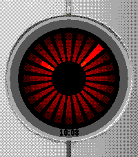
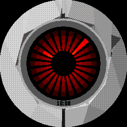

# Portal Turret

A Pebble watchface for the **Pebble Time 2** (emery) and **Pebble Round 2** (gabbro): the turret from Portal, with its eye as the clock.

It comes in two versions, built from the same code:

- **Portal Turret** (`package.json`): everything below, including the defective turret from Portal 2, with 78 voice lines. It's a big app (the Time 2's resources are about 890 KB), so installing it takes a while. The install may report that it failed: wait a minute longer, it usually installs anyway.
- **Portal Turret Lite** (`lite/package.json`): the regular turret only, with its 39 voice lines; about half the size (450 KB), so it installs faster. It has its own app id, so both can be installed side by side.

  
  

- **The eye is the clock.** The default view is a close-up of the turret's eye, a ring of 24 red wedges like the real turret's lens.
  - The wedge at the current minute glows along its whole length (the long hand).
  - The wedge at the current hour glows on its inner half (the short hand).
  - The time is also printed small on the eye's grey rim (can be turned off).
- **Flick your wrist** and the view zooms out to the whole turret, standing in a test chamber:
  - the side panels kick open and rock it onto one foot and back until it settles,
  - then it scans the room, panels sweeping left/right and up/down, with its laser sight following them,
  - after about 7 seconds it faces forward, folds its panels away and zooms back in to the eye. Flicking again while it's out keeps it out longer.
- **Flick again while it's out** and you knock it over. Like in the game, it topples onto its side firing wildly ("Malfunctioning!", "Ow ow ow ow owww"), then powers down ("Critical error", "I don't blame you"): its eye goes dark and its panels fold. A second later a claw comes down, carries it off and lowers a fresh turret, which powers up and says hello before the view zooms back in.
- **Sometimes it sees you.** With the "Chance of turret seeing you" setting, a flick can end with the turret finding you mid-scan: "Gotcha!" It swings its panels and laser straight at you (a red glare in its eye), the camera freezes, and it opens fire while red creeps in from the edges of the screen. Flick before the red closes in to knock it over and survive; otherwise it gets you.
- **Defective turrets** (not in Lite). With the "Chance of a defective turret" setting, a turret can be the defective one from Portal 2: a bare dark frame with its own lines ("Watch and learn, everybody", "I'm not defective!"). It has no bullets: when it spots you it locks on and just clicks ("Uhhh, no bullets. Sorry."), and with the "Chance of it exploding" setting (100% by default) it panics ("No, wait, wait!") and blows itself up, and the claw brings a new turret. With the "Chance of it catching fire" setting it bursts into flames first, panics, and then explodes. A new turret is picked each time the claw brings one, at start-up, and when you change the setting.
- **It talks** (Time 2 only, through its speaker): 78 voice lines (39 in Lite) picked at random, a different set for each moment and for each kind of turret. It says something when it deploys ("Who's there?", "Activated"), when it goes back to sleep ("Are you still there?", "Nap time"), when it spots you ("Gotcha!", "Hold still"), when it gets you ("Target suppressed", "Oh dear"), and when it's knocked over ("Malfunctioning", "Help!") or shuts down ("I don't blame you"). The defective turret has its own ("Locked and loaded!", "Click click click! Still defective!", "Agggh! I'm on fire!", "Well played"). The real deploy, retract, firing and shutdown sounds play too. Nothing plays when the watch is muted.

## Settings

In the Pebble app on your phone, open the watchface's settings:

- **Show the time under the eye** (on by default).
- **Volume** for the voice lines and sounds (Time 2 only). 0% turns them off.
- **Chance of turret seeing you** (0-100%, default 25%): how often a flick ends with the turret spotting you and opening fire.
- Not in Lite: **chance of a defective turret** (0-100%, default 15%), **chance of it exploding** when it tries to shoot you (default 100%), and **chance of it catching fire** first (default 50%; a burning turret always explodes).
- **Test chamber**: the turret's room, drawn from the watch's angle and showing every tile either watch can show.
  - Tap a wall panel or floor tile to switch it between white and black.
  - Hold a tile to split it into 4 small tiles, which can then be tapped one by one. Hold the middle of a split tile, where its 4 small tiles meet, to join them back.
  - "All white", "All black" and "Default" set the whole room.

The watch keeps the settings, so they survive restarts.

## How it works

Close up, the eye sits on a detailed picture of the turret: the original model, textured and smoothly shaded, rendered offline through the watch's own close-up camera (`resources/closeup~<platform>.bin`) and streamed from flash a row at a time. As the camera zooms out, the picture dissolves into the live model.

When zoomed out, the watch draws the turret itself: a low-poly copy of a 3D model (about 2000 triangles, `resources/turret.bin`) projected with a fixed-point camera (the watches have no FPU) and drawn with a painter's-algorithm scanline rasterizer and 4x4 ordered dithering, since the display has only 64 colours. The eye, the room and the laser go through the same camera so everything stays in place while it zooms and sways. The mesh is only loaded into RAM while the turret is on screen.

The voice lines are IMA ADPCM, decoded and mixed on the watch and streamed to the speaker. While a sound plays, the face leaves the CPU idle between frames and pauses for a moment in the middle of long ones, since the speaker is fed in the background. The clips are read from flash 1 KB at a time, and the clip table only once.

## Building

You need the Pebble SDK (`pebble` tool, SDK 4.x).

    pebble build                           # Portal Turret -> build/portal-turret.pbw
    pebble install --emulator emery        # or --phone <your phone's IP>

    cd lite                                # Portal Turret Lite -> lite/build/lite.pbw
    pebble build
    pebble install --phone <your phone's IP>

`lite/` holds only its own `package.json`; `src`, `resources` and `wscript` are links to the main ones. The C code turns the defective turret on when its resources are bundled (`HAS_DEFECTIVE` in `src/c/main.c`), and the phone side when its settings' message keys exist.

A big install (Portal Turret is about 1.2 MB) can make `pebble install` say "App install failed" while the phone keeps sending it; give it another minute before trying again.

### Regenerating the assets

The generated files are committed, so this is only needed to change them. The Python tools need numpy and Pillow (plus `fast-simplification` and `pygltflib` for the model, ffmpeg for the audio):

    python3 -m venv venv && venv/bin/pip install numpy pillow fast-simplification pygltflib

- **Model** (`resources/turret.bin`): download "Portal Turret" from [Sketchfab](https://sketchfab.com/3d-models/portal-turret-6716037b4f174677a9aeb85405716e4e) (glTF), then

      unzip portal_turret.zip -d model
      venv/bin/python tools/convert_model.py model/scene.gltf resources/turret.bin 2000

  It poses the rig, removes faces you can't see from outside, simplifies each part, takes face colours from the textures, fixes face winding and finds the eye.
- **Defective turret** (`resources/turret_defective.bin`, `resources/closeup_defective~*.bin`): download "Defective Turret - From Portal 2 (Original)" from [Sketchfab](https://sketchfab.com/3d-models/defective-turret-from-portal-2-original-4eca0877381f4208a94c7f43a08ffbdc), unzip it to `defective/`, then

      venv/bin/python tools/convert_model.py defective/scene.gltf resources/turret_defective.bin 2000 --profile defective
      venv/bin/python tools/render_closeup.py defective/scene.gltf resources/turret_defective.bin resources/closeup_defective --profile defective

- **Close-up pictures** (`resources/closeup~emery.bin`, `closeup~gabbro.bin`; needs the unzipped model and `resources/turret.bin`): `venv/bin/python tools/render_closeup.py model/scene.gltf resources/turret.bin resources/closeup`
- **Settings page turret** (`src/pkjs/turret_view.js`): `venv/bin/python tools/render_view.py resources/turret.bin src/pkjs/turret_view.js`
- **Voice lines and sounds** (`resources/voices.bin`, `src/c/voices.h`): save the clips from the Portal Wiki ([turret](https://theportalwiki.com/wiki/Turret_voice_lines), [defective turret](https://theportalwiki.com/wiki/Defective_Turret_voice_lines)) into a folder (file names in `tools/convert_audio.py`), make the explosion and fire sounds with `venv/bin/python tools/make_explosion.py path/to/wavs/explode.wav` and `venv/bin/python tools/make_fire.py path/to/wavs/burn.wav`, then `python3 tools/convert_audio.py path/to/wavs resources/voices.bin resources/voices_lite.bin src/c/voices.h` (`voices.bin` has every clip, `voices_lite.bin` only the regular turret's)
- **Store screenshots and GIFs** (`store/screenshots/`): `venv/bin/python tools/capture_store.py` (uses the emulator; takes a while)
- **Store banners** (`store/banner-*.png`): `venv/bin/python tools/make_store_assets.py`
- **Icon** (`resources/images/menu_icon.png` for the watch's menu, `store/icon-*.png`): `venv/bin/python tools/make_icon.py`

## Layout

    lite/package.json     Portal Turret Lite (links to the same src/, resources/, wscript)
    src/c/main.c          the watchface: camera, rasterizer, eye, room, laser, animation, settings
    src/c/audio.c         voice line playback (Time 2)
    src/pkjs/             phone side: the settings page and sending settings to the watch
    resources/            turret.bin and turret_defective.bin (the models), the close-up pictures,
                          voices.bin and voices_lite.bin (the sounds), the menu icon
    tools/                asset converters and store asset tools
    store/                appstore listing, screenshots, GIFs and banners

## Credits and license

The code is MIT licensed (see [LICENSE](LICENSE)). The turret model is
"[Portal Turret](https://sketchfab.com/3d-models/portal-turret-6716037b4f174677a9aeb85405716e4e)"
by [Igrium](https://sketchfab.com/Sam54123), CC BY 4.0, and the files made from it
are shared under the same license. The defective turret is
"[Defective Turret - From Portal 2 (Original)](https://sketchfab.com/3d-models/defective-turret-from-portal-2-original-4eca0877381f4208a94c7f43a08ffbdc)"
by [David & 3D](https://sketchfab.com/DavidAnd3D), CC BY-NC 4.0. The voice lines and sounds are (c) Valve
Corporation and not covered by the MIT license. This is a fan project, not
affiliated with Valve. Details in [CREDITS.md](CREDITS.md).
